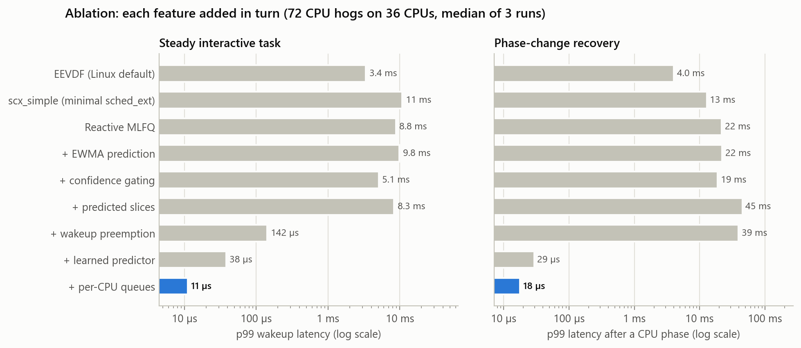

# BurstSched

A burst-predicting CPU scheduler for Linux, written as a BPF program with
[sched_ext](https://docs.kernel.org/scheduler/sched-ext.html) (Linux 6.12+). It loads into a
running kernel without recompiling it, and if it misbehaves the kernel safely falls back to
the default scheduler.

The idea comes from shortest-job-first: a scheduler would like to know how long a task will
run before it blocks. BurstSched measures every CPU burst, predicts the next one, and uses
the prediction to place a waking task directly in the right queue of a 4-level multilevel
feedback queue (MLFQ), instead of waiting for it to be demoted like classic MLFQ.

## Results

36-CPU machine, 72 CPU hogs running, all tasks scheduled by the tested scheduler, median of 3
runs. Full tables: [docs/final_ablation.md](docs/final_ablation.md).

| | EEVDF (Linux default) | scx_simple | reactive MLFQ | **BurstSched** (all features) |
|---|---|---|---|---|
| interactive wakeup latency, p99 | 4046 us | 10810 us | 10797 us | **12.3 us** |
| recovery after a CPU-bound phase, p99 | 3997 us | 10802 us | 19000 us | **18.2 us** |
| request/response service latency, p99 | 3022 us | 11099 us | 7077 us | **338 us** (285 us without per-CPU queues) |
| context switches (wakeup test) | 339k | 73k | 87k | **56k** |
| CPU-hog throughput (bogo ops/s) | 63.5k | 63.5k | 63.5k | 63.6k |
| fairness between hogs (Jain index) | 0.994 | 1.000 | 1.000 | 0.9999 |
| worst-case wait of a CPU hog | 20 ms | 62 ms | 23 ms | 82 ms (41 ms without per-CPU queues) |

The cost is the last row: BurstSched gives CPU-bound tasks long slices and lets interactive
tasks jump ahead, so the longest single wait of a CPU hog is 2-4x longer than under EEVDF.
Every number is measured the same way for every scheduler (worst-case wait by `waitmon`, a
scheduler-independent tracer).



## How it works

1. **Observe** (BPF): for every task, record each CPU burst (run time until it blocks) and
   the sleep before it.
2. **Predict**: a fixed-point EWMA in the kernel, or a learned predictor in user space that
   writes into a BPF map.
3. **Decide** (BPF): the predicted burst chooses the queue level, the time slice and whether
   a waking task may preempt a CPU running a long task.
4. **Stay safe**: aging stops starvation; a wrong prediction only costs performance.

Every feature is a load-time flag, so one binary covers the whole ablation study:

| flag | feature |
|---|---|
| (none) | reactive MLFQ with aging (baseline) |
| `-e` | EWMA burst prediction |
| `-m models/tree.txt` | learned predictor (implies `-l`) |
| `-c` | confidence gating: only act on stable predictions |
| `-s` | predicted time slices (1.25 x predicted burst, 1-40 ms) |
| `-w` | wakeup preemption by short predicted burst |
| `-P` | per-CPU queues, burst-aware placement, priority-aware work stealing |
| `-p` | partial mode: only tasks started with `build/setext` use BurstSched |
| `-o FILE` | log every finished burst to CSV |

**Learned predictor.** A small decision tree that picks which of the task's own history
values to trust for its next burst (last burst, EWMA, or the burst before last), using only
ratios of burst and sleep lengths. Because it never sees absolute sizes, it works on burst
sizes it never saw in training. A first version that predicted absolute sizes failed on
held-out workloads ([docs/run3_learned.md](docs/run3_learned.md)).

## Repository layout

```
src/            burstsched.bpf.c (scheduler), burstsched.c (loader + learned predictor), burstsched.h
utils/          setext.c: run a command under the SCHED_EXT policy (partial mode)
workloads/      wakeup_lat.c (steady interactive task), phase_change.c (CPU <-> interactive)
predictor/      train.py: train and evaluate the learned predictor
models/         tree.txt: the trained predictor used in the results
scripts/        setup, comparison and ablation runs, training-data collection
src/            waitmon.bpf.c / waitmon.c: scheduler-independent run-queue wait tracer
workloads/      rr_bench.c: request/response service benchmark
analysis/       summarize.py, phase_recovery.py, mispredict.py, plots.py
data/final/     final ablation data (per-run summaries, per-wakeup latencies, predictor eval)
figures/        report figures (PNG + SVG), generated by analysis/plots.py
docs/           development log (runs 1-3) and the final ablation
```

## Demo and saved results

You can explore the included results on Windows, macOS, or Linux with Python 3;
running the scheduler itself requires Linux. No third-party Python packages are needed
to print a summary (use `python3` instead of `python` on Linux/macOS):

```bash
python analysis/summarize.py data/final/summary_wakeup_full.csv
```

See the [demo guide](docs/demo.md) for Python dependency installation, regenerating the
figures, a short live comparison, and how to interpret the output.

## Build and run (Linux)

Requirements: Linux 6.12 or newer with `CONFIG_SCHED_CLASS_EXT=y` and BTF, root access,
clang/llvm, libelf, zlib, stress-ng, Python 3. Developed on kernel 7.0; the final results
were measured on kernel 6.17 (both Ubuntu 24.04).

```bash
mkdir -p ~/burstsched-work && cd ~/burstsched-work
git clone https://github.com/lakshya-74/BurstSched.git && cd BurstSched
./scripts/setup_lab.sh              # checks kernel, installs packages, fetches kernel source, builds

# run BurstSched (all features) for programs started with setext
sudo ./build/burstsched -p -m models/tree.txt -c -s -w -P
./build/setext ./build/wakeup_lat   # in another terminal

# reproduce the comparison
sudo ./scripts/quick_compare.sh                  # partial mode, steady workload
sudo WORKLOAD=phase ./scripts/quick_compare.sh   # phase-change workload
sudo ./scripts/final_ablation.sh                 # full mode, all configs (~45 min)
```

`make` reuses the kernel's own `tools/sched_ext` build (libbpf, bpftool, headers), so the
scheduler always matches the running kernel. The build expects the kernel source at
`~/burstsched-work/linux` (override with `make KDIR=...`).

**Full mode replaces the scheduler for every program on the machine.** Use it on a machine
nobody else is using.

The lab setup script installs the Linux build tools. For the optional Python analysis
and predictor training tools, install [requirements.txt](requirements.txt) in a virtual
environment as described in the [demo guide](docs/demo.md#install-python-dependencies).

## License

The source files carry `SPDX-License-Identifier: GPL-2.0` headers, as sched_ext BPF
schedulers must be GPL-compatible.
